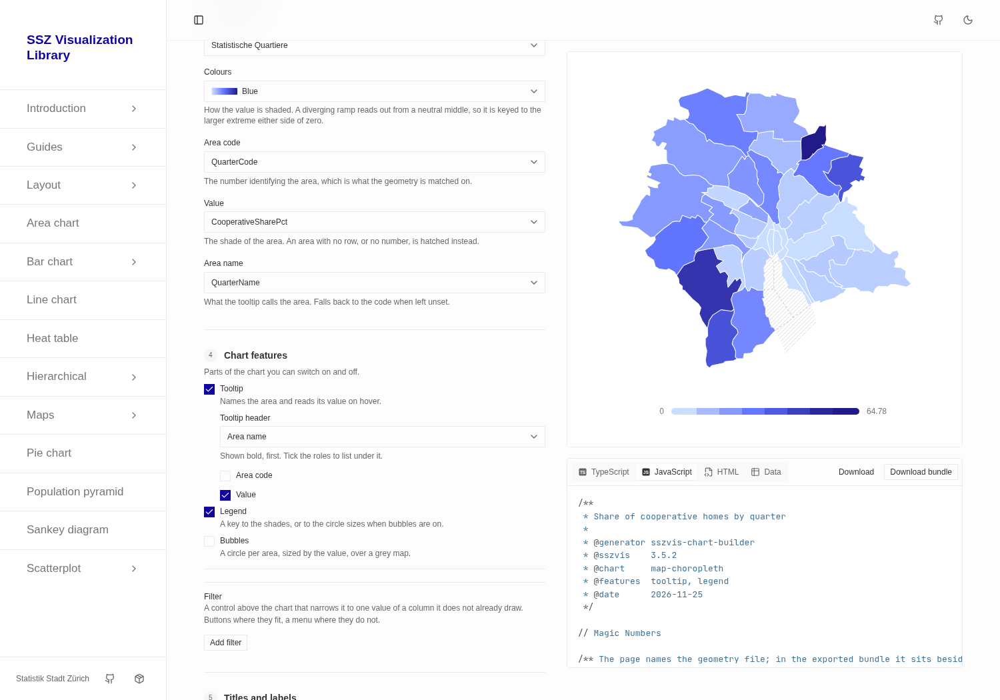
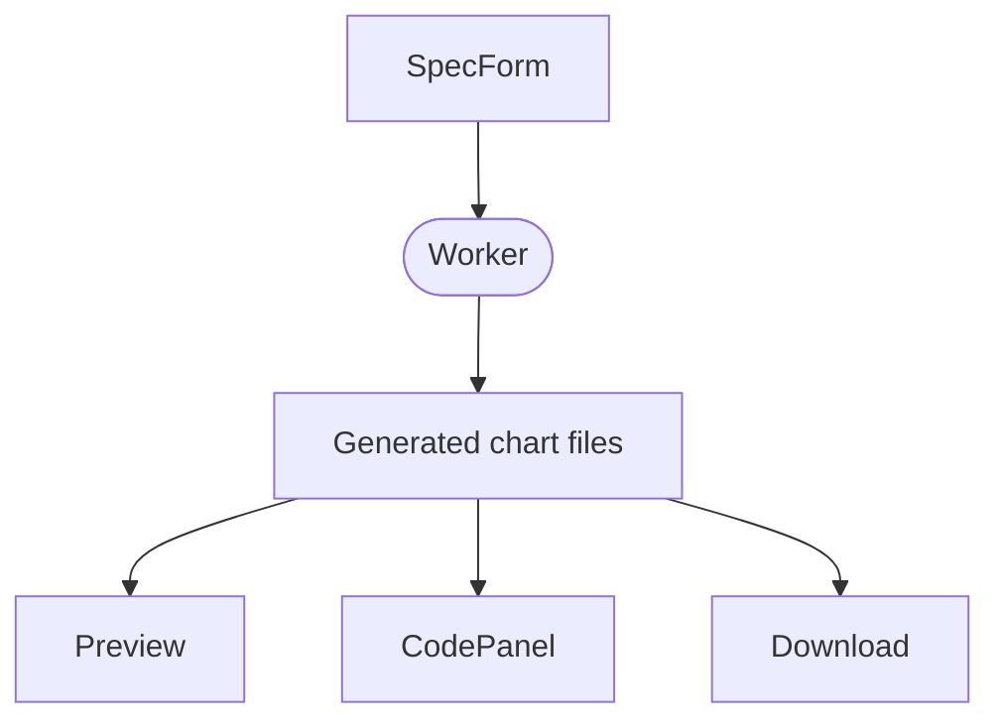

import { ExpandableImage } from "@/components/molecule/expandable-image";
import { createOGImageMetadata } from "@/lib/seo";
import cooperativeCount from "./cooperative-count.png";
import cooperativeShare from "./cooperative-share.png";

export const metadata = createOGImageMetadata({
  id: "064",
  title: "SSZVIS Chart Builder: from CSV to publishable charts",
  description:
    "How I used TypeScript templates to turn CSV data and chart settings into SSZVIS code ready to publish.",
  tags: ["sszvis", "d3", "data visualization"],
  date: "2026-11-25",
  status: "published",
  socialImage: "./cooperative-housing-editor.png",
  repo: "https://github.com/StatistikStadtZuerich/sszvis/tree/master/packages/chart-builder",
});

For the past couple of years I've been working on the open-source SSZVIS chart library and looking for ways to make it easier to use. A chart at Statistik Stadt Zürich is a folder with an HTML page, a JavaScript file, and a CSV. The page loads D3 and SSZVIS from a versioned directory on the consumer's server. An old article can keep the version it was built with while a new chart uses a newer one. It's a nice setup once you have a working chart. Getting there still means writing JavaScript.[^consumer]

That publishing setup gave me a starting point for the builder. The consumer already reviews the files a chart can load, so a separate runtime that interprets a chart spec would be another dependency to approve and maintain. I wanted the form to produce the same kind of JavaScript someone would write by hand. The TypeScript templates are useful while I'm working on the builder. The exported page runs the JavaScript directly.[^consumer]

## Two ways to map cooperative housing

Let's look at some SSZ data. Cooperatives owned about 65% of the homes in Saatlen in 2025. Altstetten had the most cooperative homes of any quarter, with 3,901, but they made up only about 20% of its housing stock. The share and the count put different places at the top of the map.[^data]

To give this a try, open the [SSZVIS docs builder](https://statistikstadtzuerich.github.io/sszvis/builder/) and download the [demo CSV](/labs/064-sszvis-chart-builder/cooperative-housing-zurich-2025.csv). It has one row per statistical quarter.[^map]

1. Use **Paste CSV** to replace the sample data, then choose **Map** as the chart type.
1. Set **Area code** to `QuarterCode` to match the boundaries and **Area name** to `QuarterName` to label the tooltip.
1. Set **Value** to `CooperativeSharePct` to shade the quarters by share. To map counts, switch **Value** to `CooperativeHomes` and turn on **Bubbles**.

<div className="my-8 grid grid-cols-1 gap-4 sm:grid-cols-2 [&>figure]:my-0">
  <ExpandableImage
    src={cooperativeShare}
    alt="Zürich quarters shaded by cooperative housing share. Saatlen is the darkest quarter."
  >
    Share of local housing stock. Saatlen has the highest share at 64.78%.
  </ExpandableImage>
  <ExpandableImage
    src={cooperativeCount}
    alt="Zürich quarters with circles sized by cooperative housing count. The largest circle is over Altstetten."
  >
    Number of cooperative homes. Altstetten has the most, with 3,901.
  </ExpandableImage>
</div>

Under the hood, a **recipe** defines what a chart type accepts and which template generates it. A **spec** records the table, column mappings, and settings for one chart. Here are the fields that change between the two maps.

```ts
const shareMap = {
  recipe: "map-choropleth",
  fields: {
    geo: "QuarterCode",
    geoLabel: "QuarterName",
    value: "CooperativeSharePct",
  },
  features: ["tooltip", "legend"],
};

const countMap = {
  ...shareMap,
  fields: { ...shareMap.fields, value: "CooperativeHomes" },
  features: [...shareMap.features, "bubble"],
};
```

The code view is there because I expect people to use it. If you've ever started a D3 chart by copying an example, you know the next job is finding all the places where that example assumes a particular table. I wanted the builder to get a chart running with your own data and give you readable code you could take into an article and keep editing.

That gave me a useful constraint when I was building the editor. Every time I changed a template, I could run the generated JavaScript in the preview and see what I'd actually given someone to publish. The docs builder puts the preview and the source next to each other because both are part of that workflow.



## From two charts to recipes

I'd previously explored a grammar of graphics with web components. This time I worked through the SSZVIS charts one at a time, starting with a line chart and a bar chart. I could see some regular patterns in how they loaded data, prepared state, and rendered. At that point it was tempting to see how much could fit in one template. [Grammar of Graphics with Web Components](/labs/050-grammar-of-graphics-web-components)

Stacked and grouped bars made that harder. The data still went through a chart with axes, bars, and tooltips, but the arrangement of series affected how the chart drew and what a hovered mark meant. Filtering and tooltips had things in common across charts. Figuring out where the common part ended was the messy bit. A change that made sense in one chart could leave another with the wrong interaction or a missing layer.

I ended up with a recipe per chart type. The recipe declares the roles, options, and features the form can offer, and it comes with its own chart template. The form edits a spec containing the recipe key, the CSV, the field mappings, and the chosen settings. A map can ask for an area code and offer Bubbles. A bar chart can ask for a category and a value. The form can draw either set of controls from the recipe summary, which contains plain data and can pass between the page and the worker.[^builder]

## What the Bubbles checkbox emits

Suppose I've already set **Value** to `CooperativeHomes`. The chart reads the count from that column whether **Bubbles** is on or off. Turning it on changes how the map draws those counts. Follow the fill and the overlay through the three files.

1. **Start with the map template**

   In the map template, `mapFill` controls the colour of each quarter. The generator replaces `__MAP_FILL__` with the function the map should use. Later in the template, `mapProps` marks a place in the SSZVIS component chain where a feature can add method calls. These are two different kinds of placeholder in the same part of the chart.[^map]

   ```ts title="chart.ts" showLineNumbers
   const mapFill = __MAP_FILL__;

   const choroplethMap = sszvis
     .choropleth<Datum>()
     .features(state.mapData.features)
     .borders(state.mapData.borders)
     // {{block:mapProps}}
     .keyName("code")
     .width(bounds.innerWidth)
     .height(bounds.innerHeight)
     // Other map settings omitted
     .fill(mapFill);
   ```

2. **Enable Bubbles**

   When I tick **Bubbles**, the generator reads `bubble.tmpl`. Its `#scalar MAP_FILL` directive gives the map a grey fill function. Its `#region mapProps` puts two calls into the component chain above. One turns off colour transitions and the other attaches `bubbleMap`, the circle renderer that the feature defines in a separate region.[^bubbles]

   ```ts title="bubble.tmpl" showLineNumbers
   // #scalar MAP_FILL () => sszvis.scaleGry()(0)

   // #region mapProps
   .transitionColor(false)
   .anchoredShape(bubbleMap)
   // #endregion
   ```

3. **Read the generated JavaScript**

   The diff shows what happens to the two placeholders. The scalar becomes a fill function, and the lines between `#region` and `#endregion` land between `.borders()` and `.keyName()`. The export also strips the TypeScript type argument. The quarters still come from the same boundary data. The polygons are grey, and the circles carry the counts.

   ```diff title="chart.js"
   - const mapFill = __MAP_FILL__;
   + const mapFill = () => sszvis.scaleGry()(0);

     const choroplethMap = sszvis
   -   .choropleth<Datum>()
   +   .choropleth()
       .features(state.mapData.features)
       .borders(state.mapData.borders)
   -   // {{block:mapProps}}
   +   .transitionColor(false)
   +   .anchoredShape(bubbleMap)
       .keyName("code")
       .width(bounds.innerWidth)
       .height(bounds.innerHeight)
       // Other map settings omitted
       .fill(mapFill);
   ```

The same feature adds the square-root radius scale so circle **area** represents the count. If **Legend** is on, it swaps the colour ramp for a circle-size legend too. Those changes live together in the feature because they all need to happen when I tick the same box.[^bubbles]

## The preview runs the generated JavaScript

The docs form sends the spec to a worker. The generator fills the template, formats the TypeScript, strips the types, and formats the JavaScript. It also returns the CSV, the host HTML, and a description of the extra files the chart needs. The worker handles syntax highlighting for the code panel too. The formatter and type stripper load on demand in the worker, away from the input the user is typing into.[^docs]



The preview needs different file locations from the exported page. The docs site supplies the preview's data and topology URLs, and the iframe gets a page with the generated chart script inlined. The export puts the script and its data alongside an HTML page. The map recipe can say it needs `stadt-zurich.json` without knowing where the docs site serves it. The same generated chart JavaScript runs in both cases.[^host]

To try the export, unzip **Download bundle** and serve the folder over HTTP. Open `index.html` through that server so D3 can fetch the CSV and topology. If you copy `chart.js` into an article, bring over the script dependencies and the host page’s `config` for the mount point and file URLs. The housing map needs D3, SSZVIS, and TopoJSON Client.

```tsx title="preview.tsx" showLineNumbers
const srcDoc = host({
  assets,
  scripts,
  files: {
    data: `data:text/csv;charset=utf-8,${encodeURIComponent(csv)}`,
    asset: (asset) =>
      new URL(assetUrl(asset), window.location.origin).href,
  },
  inline: js,
});

return <iframe key={srcDoc} srcDoc={srcDoc} />;
```

That made the preview especially useful during development. With D3, an operation can work on an empty selection without throwing. I'd make a change and the chart would load, but a line or axis might disappear. A map can look like it rendered because all the boundaries are still there, even if it lost the values that colour them. I'd look at the marks and hover over them to see whether the tooltip or ruler still worked. The iframe let me do that while working on the template, with the same script the builder would hand to someone publishing a chart.[^pitfalls]

## Conclusion

I think the housing map gets pretty close to what I wanted out of the builder. I can try the map with circles, decide I liked it better with shading, and switch back in a couple of clicks. When I have a version I want to use in an article, I can open the code tab and see how the chart was put together. If there's a detail I want to change by hand, I've already got a working chart to start from.

I still have to work through each new chart type and figure out which controls make sense for it. That took longer than I expected with grouped and stacked bars. Once I'd done that work for the map, though, I could take the same recipe into a different experiment. What if a model put together the first chart and I took over from there? That's what I tried in [the MCP Apps lab](/labs/065-sszvis-mcp-app).

---

[^consumer]: [How consumers load SSZVIS and why the builder emits code](https://github.com/StatistikStadtZuerich/sszvis/pull/498/files)

[^data]: 2025 housing stock, grouped by statistical quarter. The numerator is dwellings in the `Wohnbaugenossenschaften` ownership category. The denominator is all dwellings in that quarter. [Zürich housing stock data](https://data.stadt-zuerich.ch/dataset/bau522od5221)

[^map]: [Map recipe](https://github.com/StatistikStadtZuerich/sszvis/blob/master/packages/chart-builder/src/recipes/map-choropleth/recipe.ts)

[^builder]: [Chart builder package](https://github.com/StatistikStadtZuerich/sszvis/tree/master/packages/chart-builder)

[^bubbles]: [Bubble template](https://github.com/StatistikStadtZuerich/sszvis/blob/master/packages/chart-builder/src/recipes/map-choropleth/bubble.tmpl)

[^docs]: [Docs builder implementation](https://github.com/StatistikStadtZuerich/sszvis/tree/master/apps/docs/app/builder) · [Generator](https://github.com/StatistikStadtZuerich/sszvis/blob/master/packages/chart-builder/src/generate.ts)

[^host]: [Host page generator](https://github.com/StatistikStadtZuerich/sszvis/blob/master/packages/chart-builder/src/host.ts) · [Builder package notes](https://github.com/StatistikStadtZuerich/sszvis/blob/master/packages/chart-builder/README.md)

[^pitfalls]: [SSZVIS maintainer notes on rendering and consumer charts](https://github.com/StatistikStadtZuerich/sszvis/pull/498/files)
