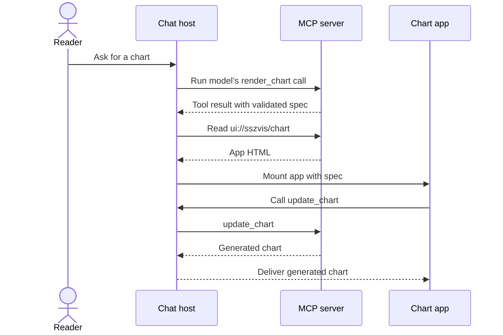

import { ExpandableImage } from "@/components/molecule/expandable-image";
import { createOGImageMetadata } from "@/lib/seo";
import inlineMap from "./chatgpt-inline-map.png";
import mapEditor from "./chatgpt-map-editor.png";

export const metadata = createOGImageMetadata({
  id: "065",
  title: "Building an SSZVIS chart editor inside chat",
  description:
    "How an Effect MCP server delivers an editable SSZVIS map to a chat host and gets its chart code and geography into the sandbox.",
  tags: ["effect", "mcp", "sszvis", "data visualization"],
  date: "2026-11-25",
  status: "published",
  socialImage: "/labs/065-sszvis-mcp-app/chatgpt-inline-map.png",
  repo: "https://github.com/StatistikStadtZuerich/sszvis/tree/master/apps/mcp-server",
});

When I first started thinking about an MCP server for SSZVIS, I figured the agent would write most of the chart. Someone could ask a question about Zürich and get a chart made with the same library Statistik Stadt Zürich uses for its articles. Getting the agent to write consistent HTML and JavaScript was the part I kept running into. This time I gave it chart recipes to choose from. The agent picks a recipe and maps the data to it, and the chart builder generates the code from that spec.

I wrote about how the recipes turn into code in [the SSZVIS chart builder lab](/labs/064-sszvis-chart-builder).

<ExpandableImage
  src={inlineMap}
  alt="The housing map appears below the prompt in ChatGPT. Hovering over Unterstrass shows its cooperative housing share."
  previewCrop={{ aspectRatio: "1660 / 1840", width: "212.77%", transform: "translate(-26.4%, -8.1%)" }}
>
  ChatGPT opens the share map inline. The tooltip shows 24.92% for Unterstrass.
</ExpandableImage>

I put the builder controls in the app to help me debug. It was quicker to try another field or turn off a feature myself than to ask the model each time. Once I could do that in chat, I started to think about what the model could do with those edits. I'd ask for a first chart, play around with it for a bit, then go back to the conversation when I had another question.

I used the same cooperative housing data as in the builder lab. The prompt asks for the share of homes owned by co-ops. Here's how to try it.[^server]

1. Open a chat client that [supports MCP Apps](https://modelcontextprotocol.io/extensions/client-matrix#support-matrix). You can also try the server in [MCPJam](https://www.mcpjam.com/).
1. Add `sszvis-mcp` as a Streamable HTTP server. It doesn't require authentication.

   ```text wrap
   https://sszvis-mcp.lloydrichards.dev/mcp
   ```

1. Start a chat, attach the [cooperative housing CSV](/labs/064-sszvis-chart-builder/cooperative-housing-zurich-2025.csv), and send this prompt.

   ```text title="prompt" wrap
   Using the attached CSV, make an interactive SSZVIS map of the share of homes owned by housing cooperatives in each Zürich quarter. Use QuarterCode for boundaries, QuarterName for tooltips, and CooperativeSharePct for shading. Show the legend and leave Bubbles off.
   ```

1. Hover over Unterstrass on the inline map to see its share of 24.92%. In ChatGPT, click **Edit**, set **Value** to `CooperativeHomes`, and turn on **Bubbles**. Other hosts may put the controls somewhere else. [See the ChatGPT editor screenshot](#going-from-an-edit-back-to-a-question).

## How the host gets the editor

I think of this in terms of who makes each request. The chat **host** runs the model's tool calls against the SSZVIS **server**. It also opens the chart **app**, which runs in an iframe and makes its own calls through the host.

I put the tools and the app on the same `/mcp` endpoint. `ChartTools` registers the toolkit and its handlers, `ChartApp` registers the editor HTML, and `TopologyResources` registers the map boundary files. `Layer.mergeAll` brings those registrations together, and `extensions` advertises MCP Apps support to the host.[^registration]

```ts title="capabilities.ts" showLineNumbers
const Capabilities = Layer.mergeAll(ChartTools, ChartApp, TopologyResources);
```
```ts title="index.ts" showLineNumbers
McpServer.layerHttp({
  // ...server identity, protocol versions, and HTTP options omitted
  path: "/mcp",
  extensions: { [EXTENSION]: {} }, // EXTENSION = "io.modelcontextprotocol/ui"
  registrations: Capabilities,
});
```

`Toolkit.make` collects the tool declarations and their schemas. `ChartToolkit.toLayer(handlers)` supplies the functions Effect runs when the host calls one of those tools. The model can call `list_recipes` to see what it can build and which columns it needs. For the housing map, it calls `render_chart` with the CSV and the quarter code, name, and share mappings. The handler builds the spec and tries to compile it while the model can still do something about an error. On success, the app gets the spec in the tool result's `structuredContent`.[^tools]

```ts title="chartTools.ts" showLineNumbers
const ChartToolkit = Toolkit.make(
  ListRecipes, RenderChart, UpdateChart, DescribeRecipes, ReadTopology,
);

const handlers = Effect.gen(function* () {
  // Set up compile using the chart builder's generator.
  return ChartToolkit.of({
    // ...other handlers omitted
    render_chart: Effect.fnUntraced(function* (params) {
      const spec = yield* specFrom(params);
      yield* compile(spec);
      return { spec };
    }),
  });
});

export const ChartTools = McpServer.toolkit(ChartToolkit).pipe(
  Layer.provide(ChartToolkit.toLayer(handlers)),
);
```

I connect the tool to the editor with a shared URI. The `render_chart` declaration puts `CHART_APP_URI` in `ui.resourceUri`, and `ChartApp` registers that same URI. When the host reads it, Effect's `McpServer.resource` returns the HTML built by Vite with the MIME type `text/html;profile=mcp-app`. The host mounts it in a sandboxed iframe and passes in the tool result. The same HTML opens every recipe because the spec tells the editor which one to draw.[^app]

```ts title="mcpApp.ts, chartTools.ts, and chartApp.ts" showLineNumbers
const renderedBy = (resourceUri: string) =>
  Tool.Meta.of({ ui: { resourceUri } });

const CHART_APP_URI = "ui://sszvis/chart";

const RenderChart = Tool.make("render_chart", {
  // Tool description and schemas omitted
}).annotate(Tool.Meta, renderedBy(CHART_APP_URI));

export const ChartApp = appResource({
  uri: CHART_APP_URI,
  html, // Imported from the Vite build
  // ...resource name, description, and CSP omitted
});
```

Once the editor has the spec, it calls `update_chart` through the host bridge to get the JavaScript it will run. That tool is registered in the same toolkit with `ui.visibility` set to `["app"]`, so the editor can call it on first render and again when I change a control. The host keeps it out of the model's tool menu.[^tools]



## Getting quarter boundaries into the sandbox

In a published article, the map script loads the CSV and the boundary file alongside it. I wanted to run that same script in chat. The MCP App can load its libraries from an approved origin, but the map's data needs a way into the iframe that the host allows.[^consumer]

I could declare the CDN as an allowed origin for the scripts in the app resource's content security policy. That handled the libraries. The host still had its own rules for what the iframe could fetch.[^app]

| What the app needs | How it gets there |
| --- | --- |
| App HTML | The host reads `ui://sszvis/chart` and mounts the iframe |
| D3, SSZVIS, TopoJSON client | The iframe loads scripts from the declared CDN origin |
| Quarter boundaries | The iframe calls `read_topology` through the host |

The part that tripped me up was that the host could read the app HTML and still refuse a resource read from inside the app. I already had the TopoJSON registered as an MCP resource. To get it into the iframe, I added `read_topology` as an app-only tool. The server sends back `stadt-zurich.json` and the app caches it by filename. It gives that data to the chart under `topo.json`, the name the generated script asks for. When I change the measure or enable Bubbles, the app can use the boundaries it already has.[^topology]

```ts
await app.callServerTool({
  name: "read_topology",
  arguments: { file: "stadt-zurich.json" },
});
```

The generated script still calls `d3.csv` and `d3.json` as it would in an article. Inside the sandbox, the app supplies implementations that read the CSV and topology it already has in memory. The CSV adapter uses `csvParseRows` and builds the row objects itself because D3's object parser uses `new Function` and the sandbox disallows it. This lets the two hosts keep using the same generated chart code even though the routes to the data are different.[^runtime]

```ts title="runtime.ts" showLineNumbers
d3.json = (url, ...rest) =>
  Object.hasOwn(files, url)
    ? Promise.resolve(files[url])
    : jsonLoader(url, ...rest);
```

## One MCP endpoint across protocol versions

In my first MCP Apps lab, the work I'd done on advertising extensions in Effect was enough to wire up the tools by hand. Getting different hosts to work reliably was where the protocol adapters helped most. I register the tools and resources once in Effect. The server and host agree on a protocol version, then Effect uses the adapter for that version to read and write the messages. This endpoint supports `2025-06-18`, `2025-11-25`, and `2026-07-28`. The host still needs MCP Apps support to open the editor.[^entry]

I spent months reading the spec and checking those versions against clients. Coming back to the app after that was a lot easier. When the map failed to load, I knew to look at what the host was forwarding from the iframe and what the MCP server was actually returning.

## Going from an edit back to a question

The inline app shows **Preview** and **Code**. On a host that supports fullscreen, **Edit** opens the controls for chart type, fields, options, and features. When I switch **Value** to `CooperativeHomes` and enable **Bubbles**, the map redraws with circles sized by count. I can try both views in the editor without starting another model turn. It gets the richer recipe descriptions for the editor through another app-only tool, `describe_recipes`.[^react-app]

<ExpandableImage
  src={mapEditor}
  alt="The ChatGPT editor with Value set to CooperativeHomes and Bubbles selected. The map tooltip shows 3,901 cooperative homes in Altstetten."
  previewCrop={{ aspectRatio: "2072 / 1745", width: "170.46%", transform: "translate(-41.34%, -0%)" }}
>
  With Value set to CooperativeHomes and Bubbles on, the Altstetten tooltip shows 3,901 cooperative homes.
</ExpandableImage>

```ts title="App-only chart update"
await app.callServerTool({
  name: "update_chart",
  arguments: { spec: editedSpec },
});
```

What I'd like to try next is going back to chat after an edit. If I've switched from share to count, the model needs to know which column I picked and that I've turned on Bubbles. Those are a couple of fields in the spec. I'd use `ui/update-model-context` to pass them to the host for the next turn, where the host supports it. The editor can already redraw the map. Feeding that edit back into the conversation is the part I still want to try.[^model-context]

That's where this gets interesting for me. I'd have both maps in mind and could ask something I probably wouldn't have thought to ask at the start.

> Which quarters have a high share of cooperative housing but relatively few cooperative homes?

---

[^server]: [SSZVIS MCP server README](https://github.com/StatistikStadtZuerich/sszvis/tree/master/apps/mcp-server)

[^tools]: [Chart tools](https://github.com/StatistikStadtZuerich/sszvis/blob/master/apps/mcp-server/src/chartTools.ts)

[^registration]: [HTTP server](https://github.com/StatistikStadtZuerich/sszvis/blob/master/apps/mcp-server/src/index.ts) · [Registration layers](https://github.com/StatistikStadtZuerich/sszvis/blob/master/apps/mcp-server/src/capabilities.ts)

[^app]: [Chart app](https://github.com/StatistikStadtZuerich/sszvis/blob/master/apps/mcp-server/src/chartApp.ts) · [App resource registration](https://github.com/StatistikStadtZuerich/sszvis/blob/master/apps/mcp-server/src/mcpApp.ts) · [MCP Apps lifecycle](https://apps.extensions.modelcontextprotocol.io/api/documents/overview.html) · [Chart host generator](https://github.com/StatistikStadtZuerich/sszvis/blob/master/packages/chart-builder/src/host.ts)

[^consumer]: [How SSZVIS charts load their data and dependencies](https://github.com/StatistikStadtZuerich/sszvis/pull/498/files)

[^topology]: [Topology fix](https://github.com/StatistikStadtZuerich/sszvis/pull/495)

[^runtime]: [Chart runtime](https://github.com/StatistikStadtZuerich/sszvis/blob/master/apps/mcp-server/ui/src/runtime.ts)

[^entry]: [SSZVIS server entry point](https://github.com/StatistikStadtZuerich/sszvis/blob/master/apps/mcp-server/src/index.ts) · [Effect protocol adapter work](https://github.com/Effect-TS/effect/pull/7265) · [Effect multi-protocol design](https://github.com/Effect-TS/effect/issues/6617)

[^react-app]: [React app](https://github.com/StatistikStadtZuerich/sszvis/blob/master/apps/mcp-server/ui/src/app.tsx)

[^model-context]: [Model context updates in MCP Apps](https://apps.extensions.modelcontextprotocol.io/api/interfaces/app.McpUiUpdateModelContextRequest.html)
