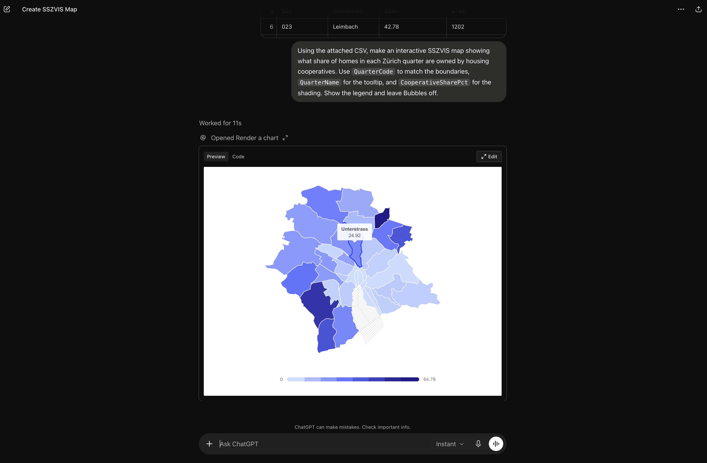
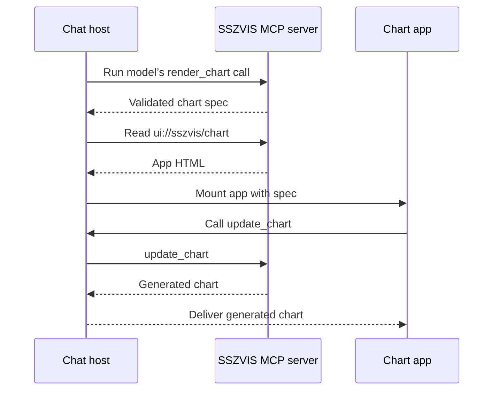
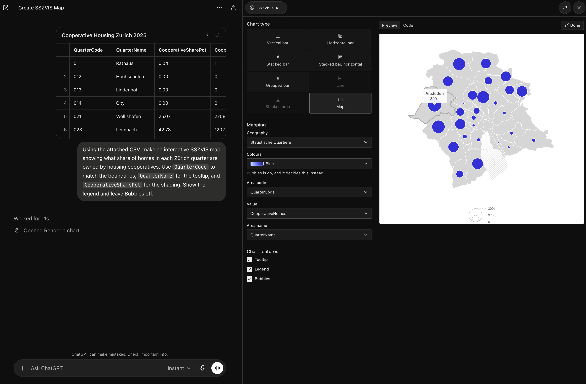

import { createOGImageMetadata } from "@/lib/seo";

export const metadata = createOGImageMetadata({
  id: "065",
  title: "Building an SSZVIS chart editor inside chat",
  description:
    "How an Effect MCP server delivers an editable SSZVIS map to a chat host and gets its chart code and geography into the sandbox.",
  tags: ["effect", "mcp", "sszvis", "data visualization"],
  date: "2026-11-25",
  status: "draft",
  repo: "https://github.com/StatistikStadtZuerich/sszvis/tree/master/apps/mcp-server",
});

My original idea for an SSZVIS MCP server was to give the agent the chart controls. Someone could ask a question about Zürich and get a visualization that followed the same conventions as charts published by Statistik Stadt Zürich. The chart builder in the docs came at the problem from the data scientist's side. They already have a table and need to decide what to do with it and how best to show it. [Building SSZVIS charts you can copy and run](/labs/064-sszvis-chart-builder)

<figure>
  <div style={{ aspectRatio: "1660 / 1840", overflow: "hidden", borderRadius: "0.5rem" }}>
    <div style={{ width: "212.77%", transform: "translate(-26.4%, -8.1%)" }}>



    </div>
  </div>
  <figcaption>ChatGPT opens the share map inline. The tooltip shows 24.92% for Unterstrass.</figcaption>
</figure>

I added the editor to the MCP App as a proof of concept and because I wanted to debug a chart without prompting the model through every change. Once I could edit the chart in place, I started to think about a different workflow for the public app. Ask a question, get a first chart, and explore it directly. If the edit raises another question, take it back to the conversation.

The cooperative housing map from the builder lab makes a good test. Start with the share of homes owned by cooperatives in each Zürich quarter. In the editor, switch to the number of cooperative homes and turn on Bubbles. That gives you a different view of the same data, and the map forces the app to solve a problem the simpler charts in my first MCP Apps experiment skipped. The iframe needs to get hold of the city boundaries as well as the chart code. [MCP Apps: Generative Data Visualization](/labs/059-generative-data-viz)

The [SSZVIS MCP endpoint](https://sszvis-mcp.lloydrichards.dev/mcp) connects to an MCP Apps host such as MCPJam over Streamable HTTP. Use the [cooperative housing CSV](/labs/064-sszvis-chart-builder/cooperative-housing-zurich-2025.csv) to follow the same example.[^server]

In MCPJam, add the endpoint as a Streamable HTTP server. In an MCP Apps chat with that server enabled, attach the CSV and use this prompt.

```text title="Demo prompt"
Using the attached CSV, make an interactive
SSZVIS map of the share of homes owned by
housing cooperatives in each Zürich quarter.
Use QuarterCode for boundaries, QuarterName
for tooltips, and CooperativeSharePct for
shading.
Show the legend and leave Bubbles off.
```

## How the host gets the editor

The **host** is the chat product. Its MCP client calls the SSZVIS **server**, and the host mounts the **app** in an iframe. The model can call `list_recipes` to learn the names of the available recipes, their column roles, and their options and features. For the housing map it calls `render_chart` with `map-choropleth`, the prepared CSV, and the mappings for area code, name, and share. The handler fills defaults, checks the request against the recipe and columns, and checks that it can generate the chart. Compiling in `render_chart` lets the model act on a generation error. The app receives the completed spec in the structured result and calls `update_chart` to get the generated files. The handler supplies a compact model-facing summary and leaves the generated source out of the result.[^tools]

```ts title="chartTools.ts · render_chart handler"
render_chart: Effect.fnUntraced(function* (params) {
  const spec = yield* specFrom(params);
  yield* compile(spec);
  return { spec };
}),
```

The link to the UI lives in the tool's metadata. Its `ui.resourceUri` points to `ui://sszvis/chart`, a resource with the MIME type `text/html;profile=mcp-app`. Vite builds the React app into one HTML file, which the server returns when the host reads that resource. The host mounts the HTML in a sandboxed iframe and delivers the tool result through the MCP Apps bridge. The same HTML can open any recipe. The spec in the result tells it which one to draw.[^app]

```ts title="mcpApp.ts · UI metadata helpers"
export const renderedBy = (resourceUri: string) =>
  Tool.Meta.of({ ui: { resourceUri } });
export const appOnly = Tool.Meta.of({ ui: { visibility: ["app"] } });
```

An app-only tool is available to the iframe through the host bridge. The model’s tool menu omits it.



## Getting quarter boundaries into the sandbox

The app declares the CDN origin in the resource's content security policy metadata. The host still controls what the iframe can fetch.[^app]

| What the app needs | How it gets there |
| --- | --- |
| App HTML | The host reads `ui://sszvis/chart` and mounts the iframe |
| D3, SSZVIS, TopoJSON client | The iframe loads scripts from the declared CDN origin |
| Quarter boundaries | The iframe calls `read_topology` through the host |

The server exposes the TopoJSON bundles as MCP resources. I hit a host that could load the app but refused a resource read for the topology from inside the iframe. The app now asks the server for the map through `read_topology`, a tool visible to the app. The app fetches `stadt-zurich.json` and caches it under that filename. When it runs the generated chart, it exposes the cached data under `topo.json`, the path the chart passes to `d3.json`. Editing the measure or turning on Bubbles keeps the same boundaries.[^topology]

```ts title="App-only topology request"
await app.callServerTool({
  name: "read_topology",
  arguments: { file: "stadt-zurich.json" },
});
```

The generated script still calls `d3.csv` and `d3.json` as it would in an article. Inside the sandbox, the app supplies implementations that read the CSV and topology it already has in memory. The CSV adapter uses `csvParseRows` and builds the row objects itself because D3's object parser uses `new Function` and the sandbox disallows it. This lets the two hosts keep using the same generated chart code even though the routes to the data are different.[^runtime]

```ts title="runtime.ts · in-memory TopoJSON loader"
d3.json = (url, ...rest) =>
  Object.hasOwn(files, url)
    ? Promise.resolve(files[url])
    : jsonLoader(url, ...rest);
```

## One MCP endpoint across protocol versions

In the earlier experiment I could build the app tools by hand once Effect let me advertise extensions. Compatibility got more predictable after the work on protocol adapters and support for the `2025-11-25` and `2026-07-28` MCP revisions. The SSZVIS server registers its tools and resources once. Effect's shared `McpSchema` abstractions give those registrations a common representation while the selected adapter handles the request and response shapes for its revision. The endpoint also declares `2025-06-18` among its adapters. Mounting the app still depends on the host supporting MCP Apps.[^entry]

I spent months reading the specification and checking how different revisions behaved. By the time I came back to MCP Apps, I had a better idea of where to look when something failed. The MCP client inside the host can ask the server for a resource. The app in the iframe has to ask the host to do that on its behalf. Those look like the same operation from the server's point of view, but the host can decide to allow one and refuse the other. That distinction mattered as soon as I tried a map.

## Going from an edit back to a question

The inline app shows **Preview** and **Code**. On a host that supports fullscreen, **Edit** opens the controls for chart type, fields, options, and features. When I change the Value field to count and enable Bubbles, the app sends the revised spec through the host to `update_chart`. That tool is app-only, so a change in the editor can redraw the chart without starting another model turn. The app uses the same tool call to generate code on the first render. It gets the richer recipe descriptions for the editor through another app-only tool, `describe_recipes`.[^react-app]

<figure>
  <div style={{ aspectRatio: "2072 / 1745", overflow: "hidden", borderRadius: "0.5rem" }}>
    <div style={{ width: "170.46%", transform: "translate(-41.34%, -0%)" }}>



    </div>
  </div>
  <figcaption>With Value set to CooperativeHomes and Bubbles on, the Altstetten tooltip shows 3,901 homes.</figcaption>
</figure>

```ts title="App-only chart update"
await app.callServerTool({
  name: "update_chart",
  arguments: { spec: editedSpec },
});
```

The current chart's field mapping and feature settings give the next question context. Sending the spec, or a compact description of the relevant fields, makes it possible for the model to refer to the same view and suggest a change. The chart's generated JavaScript would be a much larger way to convey the same decision.

MCP Apps provides `ui/update-model-context` for that next handoff when the host supports it. The current SSZVIS editor uses the bridge to redraw the map. Sending the edited spec back as context for the next user turn is a step I'd like to take with the prototype.[^model-context]

> Which quarters have a high share of cooperative housing but relatively few cooperative homes?

[^server]: [SSZVIS MCP server README](https://github.com/StatistikStadtZuerich/sszvis/tree/master/apps/mcp-server)

[^tools]: [Chart tools](https://github.com/StatistikStadtZuerich/sszvis/blob/master/apps/mcp-server/src/chartTools.ts)

[^app]: [App resource registration](https://github.com/StatistikStadtZuerich/sszvis/blob/master/apps/mcp-server/src/mcpApp.ts) · [MCP Apps lifecycle](https://apps.extensions.modelcontextprotocol.io/api/documents/overview.html) · [Chart host generator](https://github.com/StatistikStadtZuerich/sszvis/blob/master/packages/chart-builder/src/host.ts)

[^entry]: [SSZVIS server entry point](https://github.com/StatistikStadtZuerich/sszvis/blob/master/apps/mcp-server/src/index.ts) · [Effect protocol adapter work](https://github.com/Effect-TS/effect/pull/7265) · [Effect multi-protocol design](https://github.com/Effect-TS/effect/issues/6617)

[^topology]: [Topology fix](https://github.com/StatistikStadtZuerich/sszvis/pull/495)

[^runtime]: [Chart runtime](https://github.com/StatistikStadtZuerich/sszvis/blob/master/apps/mcp-server/ui/src/runtime.ts)

[^react-app]: [React app](https://github.com/StatistikStadtZuerich/sszvis/blob/master/apps/mcp-server/ui/src/app.tsx)

[^model-context]: [Model context updates in MCP Apps](https://apps.extensions.modelcontextprotocol.io/api/interfaces/app.McpUiUpdateModelContextRequest.html)
