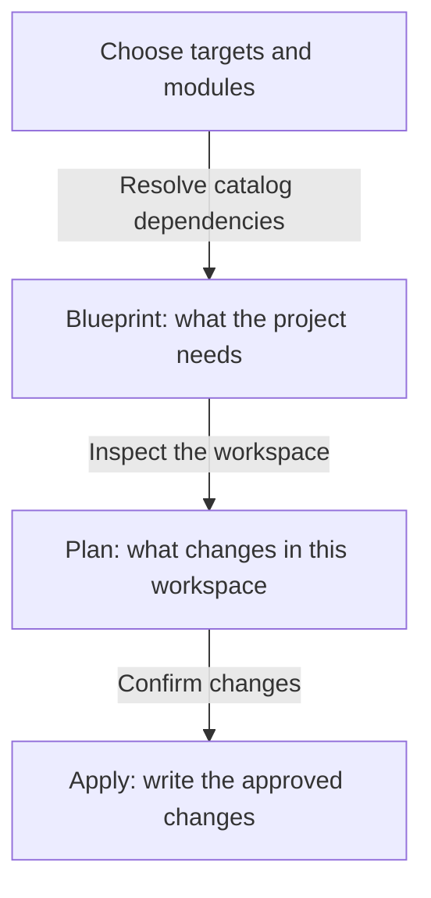

I used to start my Effect projects from the [bEvr template](https://github.com/lloydrichards/base_bevr-stack), a monorepo with a React client, an API server, and a shared domain package. It worked well when I needed the whole stack. Starting a small CLI meant spending the first part of the project deleting the web app and server. I built Stack Effect so I could start with the pieces I needed and add the others as the project grew.

<video
  className="my-6 w-full rounded-md"
  src="/images/projects/2602/init-demo.mp4"
  poster="/images/projects/2602/thumb_stack-effect.webp"
  controls
  playsInline
  preload="none"
  aria-label="Stack Effect interactive setup demo"
/>

The demo walks through choosing a runtime and tooling, then reviewing the files Stack Effect plans to create.

## Project Overview

The CLI starts with `stack-effect init`, which sets up the workspace and asks about choices like the runtime and test framework. Once the workspace exists, `stack-effect add` can add targets such as an API server, a web client, or a CLI, along with the modules they need. Both commands support a dry run, so you can see the proposed changes before writing anything.

## Challenges and Insights

### Turning a Template Into a Plan

I split the catalog from the scaffolding workflow. The catalog describes which targets and modules are available and how they fit together. The workflow turns a selection into a blueprint, then checks it against the workspace to work out which files to create, update, or leave alone. The CLI shows that plan before it writes anything.

### Previewing the Repository

The [Recipe Builder](https://stack-effect.lloydrichards.dev/builder) runs the planning and preview steps in a browser worker and writes the preview to an in-memory volume from [Effect VFS](/projects/2603-effect-vfs). You can browse the generated files and copy the [`stack-effect create` command](https://stack-effect.lloydrichards.dev/reference/cli/create) to scaffold the same workspace locally in one step.

### Building the Prompts

Choosing several modules for a target meant the prompt had to keep related choices visible as you moved through the list. I used [Effect Boxes](/projects/2600-effect-boxes) to compose the terminal layout and update it as the selection changed. The prompt implementation has its own [lab writeup](/labs/061-tui-components).

## Related Links

- [Stack Effect documentation](https://stack-effect.lloydrichards.dev/)
- [Lab 060 - turning a template into a scaffolding CLI](/labs/060-stack-effect-intro)
