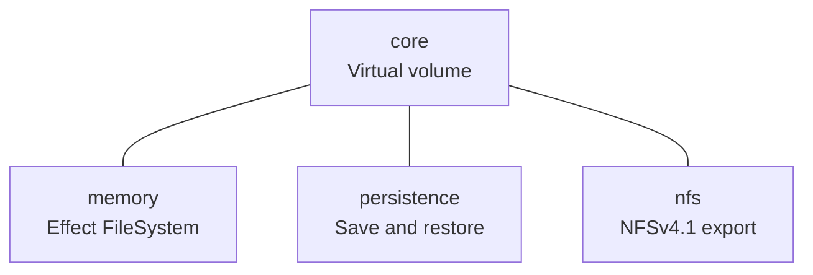
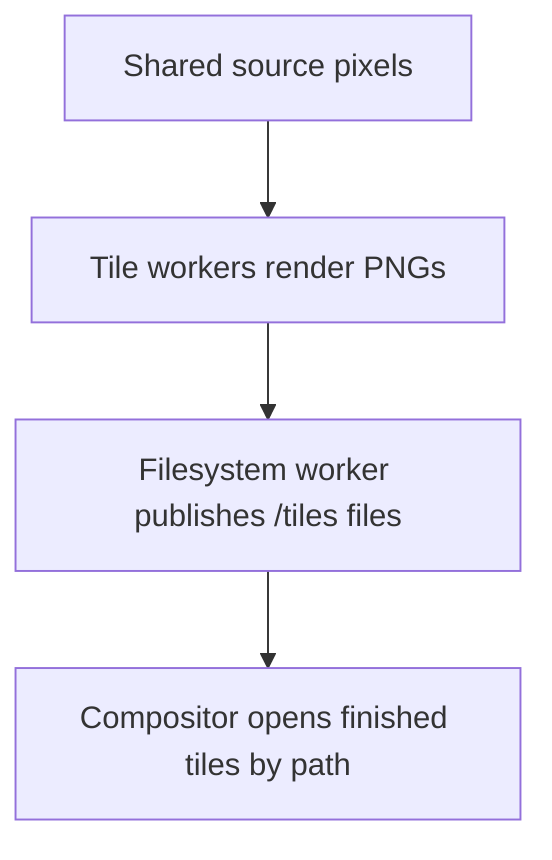

What started as a feature request for an in-memory implementation of Effect's `FileSystem` service sent me down a rabbit hole of inodes and POSIX semantics. The original idea was simple. I wanted code that already used `FileSystem` to run against a fresh volume in a test, without creating files on the host.

## Project Overview

The packages build on one filesystem model. [`@effect-vfs/core`](https://effect-vfs.lloydrichards.dev/concepts/filesystem-model) owns the volume: its file tree, open handles, access rules, and snapshots. I use core directly when a tool needs to share a volume or control what each caller can read and write.

[`@effect-vfs/memory`](https://effect-vfs.lloydrichards.dev/api/memory/memory-file-system) exposes a core volume through [Effect's](https://effect.website/) standard `FileSystem` service. You can give a test a [fresh volume](https://effect-vfs.lloydrichards.dev/guides/testing-with-an-isolated-filesystem) or bind the adapter to an existing one. Code using `readFileString` and code using core's lower-level API can then work with the same files.

[`@effect-vfs/persistence`](https://effect-vfs.lloydrichards.dev/guides/sqlite-checkpoints) saves a snapshot of that volume as a named SQLite checkpoint. Loading the snapshot lets core reconstruct a fresh volume, which you can give back to the memory adapter. The package also provides storage adapters for core's live volumes, where changes are committed as the volume is used.

### Exporting a Volume over NFS

The [NFS experiment](https://effect-vfs.lloydrichards.dev/guides/local-nfs) gives native NFSv4.1 clients another way to read a live core volume. The local read-only preview lets a client see changes made through the application. The experimental write profile builds on the same model and requires a live volume backed by storage that meets its durability requirement.

## Browser Examples

The [Image Tile Workshop](https://effect-vfs.lloydrichards.dev/examples/image-tile-workshop) splits an image into tiles. The tile workers read from a shared pixel buffer and return PNGs to the filesystem worker. The compositor reads the finished tiles by path. Rebuild a single tile to see another worker replace the file at the same path.

In the [Persistent Browser Filesystem](https://effect-vfs.lloydrichards.dev/examples/virtual-build), you can edit a small JavaScript project and build it from the virtual file tree. Switch between Editor, Reader, and Admin to see how file permissions affect the build, or save the workspace as a checkpoint.

## Challenges and Insights

### Testing the Filesystem Contract

A filesystem interface can tell you which operations are available, but the tricky parts are in how those operations behave together. For example, if you open a file and then remove its pathname, the open handle should still let you read its contents. I started by extracting a shared test suite from the behaviour of Effect's Node adapter, then used it to run the same cases against the memory implementation. That gave me something concrete to check as the volume model took shape.

## Related Links

- [Effect VFS documentation](https://effect-vfs.lloydrichards.dev/)
- [In-memory adapter on npm](https://www.npmjs.com/package/@effect-vfs/memory)
- [Lab 063 - building a filesystem with LLMs](/labs/063-llm-memory-filesystem)
